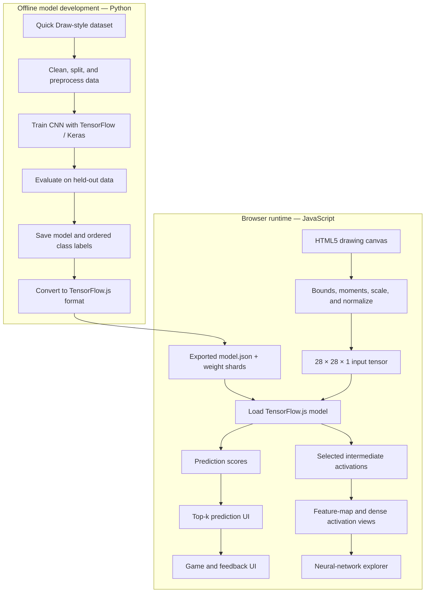

# CocoNet — Sketch Recognition Meets Explainable AI

> **Draw it. Predict it. See how the network responds.**
>
> CocoNet is a browser-based sketch-recognition game and interactive neural-network explorer. A user draws on an HTML canvas, the model predicts the sketch category, and an activation panel reveals selected intermediate representations from the network.

<p align="left">
  
  
  
  
</p>

CocoNet combines two experiences:

- **A sketch-recognition game:** draw a quick sketch and see the model's top predictions.
- **A neural-network explorer:** inspect selected feature maps to see how internal activations change as the sketch changes.

The intended deployment separates model development from model use: **Python is used to prepare data, train and evaluate the model, and export it; TensorFlow.js runs the exported model in the browser.** Python is not required at browser runtime when the model and all required assets have been exported and served as static files.

> **Project status:** This README describes the intended architecture and provides a practical implementation blueprint. Treat features, scripts, metrics, and commands as available only when the corresponding code and assets exist in your repository. Update the status and setup sections to match the shipped implementation.

---

## Contents

- [Highlights](#highlights)
- [Architecture](#architecture)
- [End-to-end workflow](#end-to-end-workflow)
- [Tech stack](#tech-stack)
- [Repository layout](#repository-layout)
- [Getting started](#getting-started)
- [Training the model with Python](#training-the-model-with-python)
- [Exporting the model to TensorFlowjs](#exporting-the-model-to-tensorflowjs)
- [Running inference in the browser](#running-inference-in-the-browser)
- [Sketch preprocessing](#sketch-preprocessing)
- [Activation explorer](#activation-explorer)
- [Performance and memory management](#performance-and-memory-management)
- [Testing and evaluation](#testing-and-evaluation)
- [Troubleshooting](#troubleshooting)
- [Privacy and data handling](#privacy-and-data-handling)
- [Roadmap](#roadmap)
- [Contributing](#contributing)
- [References](#references)
- [License](#license)

---

## Highlights

- **Interactive HTML5 canvas** for mouse, touch, or stylus drawing.
- **Live top-k predictions** with scores for the trained sketch classes.
- **Consistent 28 × 28 grayscale input** when using a model trained for that input format.
- **Image-moment-based centering** to reduce the impact of users drawing away from the canvas center.
- **Aspect-ratio-preserving resizing** to reduce geometric distortion.
- **Intermediate activation visualization** for selected convolutional, normalization, pooling, and dense layers.
- **Python training pipeline** for dataset preparation, training, evaluation, and model export.
- **Browser-side inference** with TensorFlow.js and a supported acceleration backend, such as WebGL.
- **Resource-aware rendering** using inference scheduling, reusable canvases, and explicit tensor disposal.

The exact supported classes, model architecture, and performance depend on the trained model and the implementation included in the repository.

## Architecture



### Runtime responsibilities

| Component | Responsibility |
|---|---|
| **Python training code** | Prepare training data, build and train the model, evaluate it, save model artifacts, and preserve the class-index mapping. |
| **Model conversion** | Convert the trained model into a TensorFlow.js-compatible format. This is a build-time step, not a browser request to Python. |
| **Drawing canvas** | Capture pointer input and render user strokes. |
| **Preprocessing pipeline** | Extract the sketch, center and scale it consistently, and create the exact input tensor expected by the model. |
| **TensorFlow.js inference** | Run the exported model and obtain final predictions. |
| **Activation extractor** | Expose selected intermediate layer outputs for diagnostic rendering. |
| **Visualization UI** | Render class scores, feature maps, and selected dense-layer values. |

## End-to-end workflow

1. **Collect and prepare data** in Python. Split examples into training, validation, and test sets before model selection.
2. **Train a CNN** using the intended input shape, preprocessing convention, and class-index order.
3. **Evaluate the model** on held-out sketches and inspect per-class errors rather than relying only on training accuracy.
4. **Export the trained model** and save the ordered class labels alongside it.
5. **Convert the model** into TensorFlow.js format and place the generated model files in the web application's public assets.
6. **Load the model once** when the browser application starts.
7. As the user draws, **preprocess the current sketch** and run inference on the latest input.
8. **Update the predictions and diagnostic views** without starting an unbounded backlog of expensive inference work.

The browser preprocessing must match the training preprocessing. A model trained on one color polarity, centering convention, or pixel range can perform poorly if the browser supplies another.

## Tech stack

| Technology | Role |
|---|---|
| **Python** | Dataset processing, training, evaluation, and model-artifact preparation. |
| **TensorFlow / Keras** | Define, train, validate, and save the CNN. |
| **NumPy** | Efficient numeric preprocessing and dataset manipulation. |
| **scikit-learn** *(optional)* | Dataset splitting and evaluation utilities. |
| **Matplotlib** *(optional)* | Training curves and offline evaluation plots. |
| **TensorFlow.js** | Load the exported model, run inference, and extract supported intermediate outputs in the browser. |
| **JavaScript / TypeScript** | Canvas events, input normalization, inference scheduling, and UI updates. |
| **HTML5 Canvas 2D** | Drawing input and rendering activation channels. |
| **WebGL backend** | GPU-accelerated tensor operations when supported by the browser/device. |
| **Quick, Draw! dataset** *(intended)* | Potential source of sketch examples, subject to its terms and the specific subset used. |

A JavaScript framework such as React or a bundler such as Vite is optional; use the tooling actually present in the repository. WebGL acceleration is not guaranteed on every browser or device.

## Repository layout

A recommended structure is shown below. Adapt filenames to the actual project rather than creating empty placeholder files just to match this diagram.

```text
CocoNet/
├── public/
│   └── models/
│       └── coconet/
│           ├── model.json            # Generated TensorFlow.js model topology
│           ├── group1-shard*.bin     # Generated model weights
│           └── labels.json           # Ordered class names
├── src/
│   ├── components/
│   │   ├── DrawingCanvas.*
│   │   ├── PredictionPanel.*
│   │   └── ActivationExplorer.*
│   ├── ml/
│   │   ├── loadModel.*
│   │   ├── preprocessSketch.*
│   │   ├── predict.*
│   │   └── extractActivations.*
│   └── styles/
├── training/
│   ├── train.py                     # Dataset/model training entry point
│   ├── evaluate.py                  # Held-out evaluation
│   └── export_model.py              # Optional model export helper
├── data/                            # Usually ignored by Git
├── artifacts/                       # Local training outputs; usually ignored
├── tests/
├── requirements-training.txt
├── package.json
├── .gitignore
├── README.md
└── LICENSE
```

Do not commit large raw dataset archives, local virtual environments, or temporary checkpoints by default. Publish only the model artifacts needed by the web app, and use an appropriate release or artifact-hosting approach if those files are too large for ordinary Git history.

## Getting started

### Prerequisites

- **Python** for model training and evaluation.
- **Node.js and npm** if the frontend uses npm-based tooling.
- A modern browser with Canvas 2D support.
- A trained model converted to TensorFlow.js format, plus the correct ordered class-label file.

### 1. Clone the repository

```bash
git clone https://github.com/<your-username>/CocoNet.git
cd CocoNet
```

Replace the placeholder with the actual GitHub repository URL.

### 2. Set up the Python environment

Create an isolated environment so ML dependencies do not interfere with other Python projects.

**Windows PowerShell**

```powershell
py -m venv .venv
.\.venv\Scripts\Activate.ps1
python -m pip install --upgrade pip
```

**macOS / Linux**

```bash
python3 -m venv .venv
source .venv/bin/activate
python -m pip install --upgrade pip
```

Install the packages listed in the repository's training requirements file:

```bash
pip install -r requirements-training.txt
```

If that file does not exist yet, create it with the dependencies actually used by your training scripts. A typical starting set is `tensorflow`, `numpy`, `scikit-learn`, and `matplotlib`; exact compatible versions depend on the Python version and deployment environment. Do not assume the training and TensorFlow.js conversion dependencies will always resolve cleanly in a single environment.

### 3. Install frontend dependencies

From the repository root, if `package.json` is present:

```bash
npm install
```

### 4. Start the frontend

Use the script configured by `package.json`. For example, if the project defines a Vite `dev` script:

```bash
npm run dev
```

Open the local URL printed in the terminal. If the repository uses a different build tool or has no frontend scaffold yet, follow its actual entry point instead of assuming this command exists.

## Training the model with Python

Python owns the **offline model-development workflow**. It is not part of the interactive prediction loop in the browser.

### Recommended training stages

1. **Load the dataset.** Record the source, version or subset, class list, and applicable terms.
2. **Build a stable label mapping.** Every class index used during training must match the class order loaded by the frontend.
3. **Split the data.** Keep a validation set for model selection and a separate test set for final evaluation. Avoid leakage between splits.
4. **Preprocess sketches.** Use the same image dimensions, color polarity, centering, scaling, and value range intended for browser inference.
5. **Train the model.** Save training configuration, random seeds where applicable, and checkpoints needed for reproducibility.
6. **Evaluate.** Measure held-out accuracy and per-class performance; inspect confusing categories and incomplete/ambiguous examples.
7. **Save artifacts.** Export the model and write the exact ordered class names used by the output layer.

### Example CNN architecture

The following is an **illustrative baseline**, not a claim about the model currently trained in the repository. It expects preprocessed grayscale arrays shaped `(28, 28, 1)` and integer class labels shaped `(N,)`.

```python
import json
from pathlib import Path

import tensorflow as tf
from tensorflow import keras
from tensorflow.keras import layers

# x_train / x_val: float arrays shaped (N, 28, 28, 1)
# y_train / y_val: integer class IDs in [0, num_classes - 1]
# class_names: list where class_names[i] is the label for class ID i

num_classes = len(class_names)

model = keras.Sequential([
    keras.Input(shape=(28, 28, 1), name="sketch_input"),
    layers.Conv2D(32, 3, padding="same", use_bias=False, name="conv_1"),
    layers.BatchNormalization(name="bn_1"),
    layers.Activation("relu", name="relu_1"),
    layers.MaxPooling2D(name="pool_1"),
    layers.Conv2D(64, 3, padding="same", use_bias=False, name="conv_2"),
    layers.BatchNormalization(name="bn_2"),
    layers.Activation("relu", name="relu_2"),
    layers.MaxPooling2D(name="pool_2"),
    layers.Flatten(name="flatten"),
    layers.Dense(128, activation="relu", name="dense_features"),
    layers.Dropout(0.3, name="dropout"),
    layers.Dense(num_classes, activation="softmax", name="class_probabilities"),
])

model.compile(
    optimizer=keras.optimizers.Adam(),
    loss="sparse_categorical_crossentropy",
    metrics=["accuracy"],
)

model.fit(
    x_train,
    y_train,
    validation_data=(x_val, y_val),
    epochs=30,
    batch_size=128,
    callbacks=[
        keras.callbacks.EarlyStopping(
            monitor="val_loss", patience=5, restore_best_weights=True
        )
    ],
)

# Keep model and label mapping together as versioned artifacts.
Path("artifacts").mkdir(parents=True, exist_ok=True)
model.save("artifacts/coconet_model.h5")
with open("artifacts/labels.json", "w", encoding="utf-8") as file:
    json.dump(class_names, file, ensure_ascii=False, indent=2)

print("Saved model and labels. Test the exported model before deployment.")
```

Before running this example, provide `x_train`, `y_train`, `x_val`, `y_val`, and `class_names` from your actual dataset pipeline. Normalize the images consistently, and do not include a class in `class_names` unless it corresponds to one output unit in the model.

### Training checklist

- [ ] Input shape, channel order, pixel range, and background polarity are documented.
- [ ] The label-to-index mapping is saved with the model.
- [ ] Train/validation/test splits are separated appropriately.
- [ ] Evaluation is performed on held-out sketches.
- [ ] The model can be loaded and run on a known test input.
- [ ] The Python preprocessing output has been compared against the browser preprocessing output.

## Exporting the model to TensorFlow.js

Model conversion is a **build-time step**. The browser loads the converted `model.json` and referenced weight shards; it does not need to run Python to make a prediction.

TensorFlow.js provides a converter for supported TensorFlow/Keras models. Standard Keras layers are the easiest path; custom Python-only operations, unsupported layers, and some Lambda/custom layers may prevent direct conversion. Consult the [official conversion guide](https://www.tensorflow.org/js/tutorials/conversion/import_keras) and [converter documentation](https://github.com/tensorflow/tfjs/tree/master/tfjs-converter) for the model format you use.

### 1. Create a separate conversion environment

The converter has a substantial dependency tree and can conflict with an existing TensorFlow/Keras setup. A clean virtual environment is often the simplest option. Install a converter version compatible with the model artifact and Python environment:

```bash
python -m venv .venv-convert
```

Activate it using the appropriate command for your operating system, then run:

```bash
python -m pip install --upgrade pip
python -m pip install tensorflowjs
```

### 2. Convert the saved model

Run the converter in the environment where `tensorflowjs_converter` is installed. For a Keras HDF5 model:

```bash
tensorflowjs_converter \
  --input_format=keras \
  --output_format=tfjs_layers_model \
  artifacts/coconet_model.h5 \
  public/models/coconet
```

On Windows PowerShell, use a single line or PowerShell line-continuation syntax appropriate to your shell. The output directory should contain `model.json` and one or more weight-shard `.bin` files.

The precise supported format can vary with converter version. If your model is saved in a different format or the command fails, follow the official converter instructions for that format rather than blindly renaming the file.

### 3. Copy the label file

```bash
# Run from the repository root; create the output folder if necessary.
mkdir -p public/models/coconet
cp artifacts/labels.json public/models/coconet/labels.json
```

For Windows, copy the file using File Explorer or the PowerShell `Copy-Item` command. Ensure `labels.json` is ordered exactly like the model's output neurons. A model file and a label file from different training runs must not be mixed.

### 4. Verify the artifacts

The deployment folder should resemble:

```text
public/models/coconet/
├── model.json
├── group1-shard1of1.bin    # Example name; converter output may differ
└── labels.json
```

Check that every shard referenced in `model.json` is present and accessible from the web server. Do not manually rename shard files unless you also update the model manifest.

## Running inference in the browser

Load the model once, rather than on every stroke. With a converted TensorFlow.js **LayersModel**, a minimal loader looks like this:

```javascript
import * as tf from "@tensorflow/tfjs";

export async function loadCocoNetModel() {
  // The path assumes public/models/coconet/model.json is served at /models/coconet/model.json.
  await tf.ready();
  const model = await tf.loadLayersModel("/models/coconet/model.json");
  return model;
}
```

The exact asset URL depends on your frontend bundler and deployment base path. If using a Vite-style `public` directory, its files are typically served from the site root during development; adjust this for deployments hosted under a subpath.

### Prediction data contract

Before calling `model.predict`, verify that the input is:

- shaped as `[1, 28, 28, 1]` for a model trained on 28 × 28, single-channel images;
- normalized to the exact value range used in training;
- using the expected foreground/background polarity;
- finite and free of unexpected empty-input values.

For a softmax classification model, the model output is usually a vector of class scores. The `labels.json` array maps each output index to its name. Softmax scores are not guaranteed to be calibrated probabilities.

### Model backend

TensorFlow.js can use an available backend such as WebGL for acceleration. Backend availability and performance depend on the browser, device, driver, and TensorFlow.js build. Keep the UI functional if acceleration is unavailable, and measure performance on the browsers/devices you intend to support.

## Sketch preprocessing

A neural network only sees a tensor; it does not know whether a human considers a drawing centered or recognizable. CocoNet's preprocessing pipeline should transform every drawing using the same conventions used during training.

### 1. Read the drawing and handle empty input

Read the drawing canvas or an offscreen preprocessing canvas. Detect whether any foreground pixels exist. An untouched or cleared canvas should be handled explicitly rather than passed through as an ordinary sketch.

### 2. Find the foreground bounds

For foreground pixels, calculate:

- `x_min`, `y_min`: top-left position;
- `x_max`, `y_max`: bottom-right position;
- `width = x_max - x_min + 1`;
- `height = y_max - y_min + 1`.

Use a consistent threshold or alpha test to distinguish strokes from the background. Browser antialiasing can create low-intensity edge pixels, so test this threshold with real input.

### 3. Calculate image moments

For a foreground intensity or weight image `I(x, y)`, the zeroth moment is:

\[
M_{00} = \sum_x \sum_y I(x,y)
\]

The first-order moments give the center of mass:

\[
\bar{x} = \frac{M_{10}}{M_{00}},\quad
\bar{y} = \frac{M_{01}}{M_{00}}
\]

where

\[
M_{10} = \sum_x \sum_y xI(x,y),\quad
M_{01} = \sum_x \sum_y yI(x,y).
\]

For a binary mask, `I` can be 1 for foreground and 0 for background. For grayscale input, intensity may be used as a weight if its polarity is defined consistently. Always guard against `M00 = 0` for an empty sketch.

### 4. Center and scale without distorting the sketch

Use one scale factor for both axes:

\[
s = \frac{L}{\max(\text{width},\text{height})}
\]

Here `L` is the maximum side length allocated to the resized drawing before padding. Use padding to fit the sketch into a square rather than stretching a wide drawing and a tall drawing independently. Centering by bounding box and centering by image moments are different policies; select and validate the policy that best matches training data.

### 5. Produce the model tensor

For a common single-channel CNN input, the final shape is:

```text
[batch, height, width, channels] = [1, 28, 28, 1]
```

The pixel values may be expected in `[0, 1]`, `[-1, 1]`, or another documented range. Some training pipelines invert the colors. Do not assume a particular range or polarity: record it in the model configuration and make the browser implementation match it.

### 6. Validate parity between Python and JavaScript

Use a small collection of fixed sketches and compare the normalized output from both preprocessing implementations. Pixel values should be close within a defined tolerance, allowing for documented differences in image-resizing implementations. Parity tests are important: two images that look similar to a person may still produce different model inputs.

## Activation explorer

The activation explorer exposes selected internal tensors alongside the final output. It is a **diagnostic aid**, not a complete explanation of why the model made a prediction.

### Multi-output model for a Keras-style LayersModel

For a model loaded with `tf.loadLayersModel`, an additional model can share the original inputs and emit selected intermediate layer outputs. Layer names must exist in the loaded model.

```javascript
import * as tf from "@tensorflow/tfjs";

export function createActivationModel(model, layerNames) {
  const selectedLayers = layerNames.map((name) => model.getLayer(name));

  return tf.model({
    inputs: model.inputs,
    outputs: [
      ...selectedLayers.map((layer) => layer.output),
      model.outputs[0],
    ],
  });
}
```

This pattern applies to compatible `tf.LayersModel` architectures. A `tf.GraphModel`, unsupported converted operation, or model with a different graph structure may require a different diagnostic strategy. Build the activation model once, not on every pointer event.

### What the views represent

- **Convolutional feature maps:** channel-wise activations at spatial locations. Early layers may respond to local patterns; deeper features can combine patterns into more abstract representations. The exact meaning of a channel should not be asserted without investigation.
- **Batch-normalization / activation outputs:** tensors after the corresponding operation, if that is the layer output selected.
- **Pooling outputs:** lower-resolution feature maps that summarize local regions.
- **Dense-layer outputs:** one-dimensional activations are usually easier to interpret as a bar chart or activation strip than as a fabricated spatial image.
- **Final output:** model scores for the ordered class list, displayed separately from intermediate feature maps.

### Render feature maps carefully

For a selected activation channel, the UI may scale values to a display range such as `[0, 255]`. This normalization is only for visualization; it must never modify the tensor sent into the model. Handle constant channels (`max === min`) without division by zero, and label each view with the layer name, channel index, and tensor shape.

Because visualized channels can differ greatly in count and size, provide a curated layer list and a limit on the number of channels rendered at once. Rendering every channel of every layer is rarely necessary for a useful demo.

## Performance and memory management

A real-time drawing UI can generate pointer events faster than the model can process them. The objective should be **responsive, measured behavior**, not an unverified promise of 60 FPS on every device.

### Recommended practices

1. **Load models once.** Keep the inference model and activation model alive for the application's lifetime.
2. **Throttle updates.** Coalesce input events with `requestAnimationFrame`, debounce at an appropriate interval, or use a latest-input queue. Avoid accumulating a long queue of outdated sketches.
3. **Separate costs.** Measure preprocessing, inference, tensor readback, and DOM/canvas rendering separately.
4. **Inspect fewer layers first.** Update only a small set of representative channels by default; let users opt into more detail.
5. **Reuse canvases and DOM nodes.** Do not rebuild an entire activation grid on every mouse movement.
6. **Dispose temporary tensors.** Keep long-lived model weights, but dispose tensors created for individual input/output operations.
7. **Warm up before benchmarking.** The first inference can include initialization and shader-compilation overhead; report repeated measurements, not only the first run.

### Tensor ownership example

`tf.tidy()` is useful for synchronous tensor operations. It cannot automatically manage arbitrary asynchronous work, and tensors returned from its callback remain the caller's responsibility. For asynchronous reads, keep outputs alive until the reads finish, then dispose them.

```javascript
async function inspectSketch(activationModel, inputTensor) {
  // Outputs returned from tidy survive its cleanup and must be disposed below.
  const outputs = tf.tidy(() => {
    const result = activationModel.predict(inputTensor);
    return Array.isArray(result) ? result : [result];
  });

  try {
    // Read tensors before disposing them. Render the returned arrays as needed.
    const arrays = await Promise.all(outputs.map((tensor) => tensor.data()));
    return arrays;
  } finally {
    outputs.forEach((tensor) => tensor.dispose());
  }
}
```

The caller still owns and must dispose `inputTensor` when it is no longer needed. Adapt this example to the application's actual prediction/output types, especially if it mixes persistent tensors, multiple inputs, or asynchronous operations. Do not put `await` inside a `tf.tidy()` callback.

### Metrics worth recording

- model download and load time;
- preprocessing latency per update;
- inference latency per update;
- activation readback and rendering latency;
- active tensor count over a long draw/clear session;
- sustained rendering responsiveness on representative devices;
- held-out accuracy and per-class failure cases.

## Testing and evaluation

### Preprocessing tests

- [ ] Empty/cleared canvas is handled without `NaN` or infinite values.
- [ ] A single dot remains visible after normalization.
- [ ] Horizontal, vertical, wide, and tall sketches preserve their geometry.
- [ ] Off-center sketches are normalized using the expected centering policy.
- [ ] Output shape and value range match the model contract.
- [ ] Python and browser preprocessing agree on fixed test images within a defined tolerance.

### Model tests

- [ ] The exported model loads from the deployed URL.
- [ ] Every weight shard referenced by `model.json` is served correctly.
- [ ] Output size matches the number of labels.
- [ ] Class indices map to the correct `labels.json` entries.
- [ ] Predictions are finite on representative test inputs.
- [ ] Every configured activation layer exists and returns a supported tensor shape.

### Runtime tests

- [ ] Repeated drawing and clearing does not cause unbounded tensor growth.
- [ ] Slow inference does not create an ever-growing backlog.
- [ ] Canvas resizing and high-DPI displays do not break pointer coordinates.
- [ ] The interface remains understandable on small screens and with keyboard navigation where supported.
- [ ] The app fails gracefully when the model cannot load or WebGL is unavailable.

### Evaluation recommendations

Evaluate on held-out drawings. Useful metrics include accuracy, top-k accuracy, per-class precision/recall, a confusion matrix, and latency on representative devices. Test ambiguous and incomplete sketches, not just clean examples. A high softmax score should not automatically be interpreted as certainty or correctness.

## Troubleshooting

| Problem | Checks and likely fixes |
|---|---|
| `npm run dev` is missing | Inspect `package.json`; use the script configured by the repository's actual frontend tooling. |
| Python dependencies conflict | Use a clean virtual environment; isolate TensorFlow.js conversion from model training if necessary. |
| Model conversion fails | Confirm converter/model-format compatibility and whether the architecture uses unsupported custom or Lambda layers. Consult the official converter documentation. |
| Model cannot load in browser | Check the URL, static hosting rules, CORS for external hosting, missing shards, and browser network-console errors. |
| Labels do not match predictions | Verify that `labels.json` has the exact same order as the class indices used during training. |
| Predictions are poor | Check color polarity, centering, interpolation, input shape, pixel normalization, and dataset distribution. |
| Activation panel is blank | Check layer names, model type (`LayersModel` vs `GraphModel`), output ranks, and whether tensors are disposed too early. |
| Browser slows down over time | Throttle inference, display fewer channels, reuse canvases, and audit tensor disposal. |
| WebGL backend is unavailable | Check browser/device compatibility and configure a supported fallback backend if the app includes one. |
| Empty canvas receives a confident label | Add explicit empty-input detection and define how blank input should behave. |

## Privacy and data handling

The intended design performs model inference and activation visualization in the browser after the frontend and model files have loaded. In that setup, user drawings do not need to be sent to a prediction server. However, hosting providers may receive normal requests for the page and model assets, and analytics, logging, multiplayer, or telemetry features can change the data flow.

Document the actual behavior of the deployed application. Do not claim that drawings are never transmitted unless network behavior has been verified and any analytics or remote services have been accounted for.

## Roadmap

Update this checklist as work is implemented and tested.

- [ ] Implement a responsive canvas for mouse, touch, and stylus input.
- [ ] Build a reproducible Python dataset and training pipeline.
- [ ] Keep Python and browser preprocessing consistent with automated parity tests.
- [ ] Evaluate the model on held-out sketches and document its supported classes.
- [ ] Automate export and validate generated TensorFlow.js assets.
- [ ] Display live top-k predictions with clear class labels.
- [ ] Build the configurable multi-output activation explorer.
- [ ] Visualize convolutional maps and dense activations using suitable views.
- [ ] Add inference scheduling and audit tensor disposal.
- [ ] Add accessible controls, keyboard interaction, and mobile layout.
- [ ] Add optional game rounds, prompts, scoring, or multiplayer features.
- [ ] Publish a live demo and example screenshots or a short recording.

## Contributing

Contributions, bug reports, and ideas are welcome.

1. Open an issue describing the bug, feature, or question.
2. Keep preprocessing and label-mapping changes synchronized across Python and JavaScript.
3. Add tests for changes to data transforms, model export, inference, or tensor lifecycle.
4. Avoid committing raw datasets, private user data, local environments, or large temporary checkpoints.
5. Update this README when setup instructions, model contracts, or supported features change.

Before opening a pull request, run the available lint, test, build, and training/evaluation checks defined by the repository.

## References

- [Google Creative Lab — Quick, Draw! Dataset](https://github.com/googlecreativelab/quickdraw-dataset)
- [TensorFlow.js — Import a Keras model](https://www.tensorflow.org/js/tutorials/conversion/import_keras)
- [TensorFlow.js — Model conversion guide](https://www.tensorflow.org/js/guide/conversion)
- [TensorFlow.js — Save and load models](https://www.tensorflow.org/js/guide/save_load)

Review the dataset's current terms and attribution requirements before redistribution. Dataset mirrors and pretrained artifacts may have different terms from the original source.

## License

No license has been specified in this README. Add a `LICENSE` file with the license selected for this project before describing CocoNet as open source. Also confirm that any datasets, pretrained weights, icons, or other third-party assets can be used under their respective terms.
