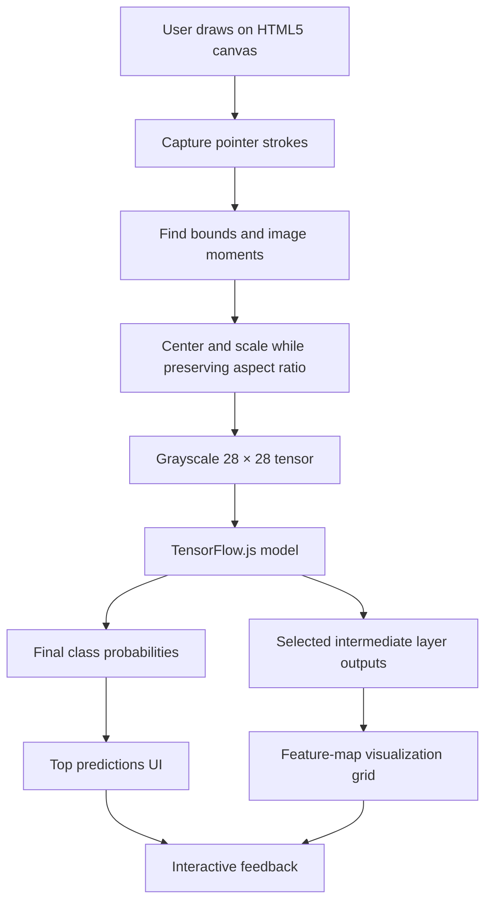

# CocoNet — Interactive Sketch Recognition & Neural Network Explorer

> **Draw it. Predict it. See how the network thinks.**
>
> CocoNet is a browser-based sketch-recognition game and interactive neural-network diagnostic platform. It combines real-time drawing classification with visual explanations of intermediate model activations, helping users explore how a neural network transforms simple strokes into increasingly meaningful visual features.

<!-- Replace or add these badges when the repository details are known. -->
<p align="left">
  
  
  
  
</p>

CocoNet aims to make machine learning feel less like a mysterious box of matrix multiplication and more like something you can inspect, question, and understand. Users sketch on an HTML5 canvas, receive live class predictions, and inspect feature maps from selected layers of the model—all intended to run locally in the browser without sending drawings to a prediction server.

---

## Table of Contents

- [Overview](#overview)
- [Project Goals](#project-goals)
- [Key Features](#key-features)
- [How It Works](#how-it-works)
- [System Architecture](#system-architecture)
- [Image Preprocessing Pipeline](#image-preprocessing-pipeline)
- [Neural Network & Activation Explorer](#neural-network--activation-explorer)
- [Gameplay Flow](#gameplay-flow)
- [Technology Stack](#technology-stack)
- [Getting Started](#getting-started)
- [Model and Dataset](#model-and-dataset)
- [Performance and Memory Management](#performance-and-memory-management)
- [Suggested Project Structure](#suggested-project-structure)
- [Configuration](#configuration)
- [Testing and Validation](#testing-and-validation)
- [Known Limitations](#known-limitations)
- [Roadmap](#roadmap)
- [Contributing](#contributing)
- [Privacy](#privacy)
- [Acknowledgements](#acknowledgements)
- [License](#license)

---

## Overview

Most sketch-recognition applications show a drawing and return a label. CocoNet is intended to show both the **answer** and part of the **process behind the answer**.

As a user draws a sketch, the application will:

1. Capture pointer strokes on an HTML5 canvas.
2. Find the drawing bounds and estimate the sketch's center of mass using image moments.
3. Preserve the drawing's aspect ratio while fitting it into a normalized input image.
4. Convert the result into a grayscale **28 × 28** tensor.
5. Run inference with a TensorFlow.js model in the browser.
6. Display the highest-probability class predictions.
7. Extract selected intermediate layer outputs and render their feature maps in a diagnostic panel.

The intended result is a lightweight, interactive experience inspired by drawing-guessing games such as *Quick, Draw!* and *Skribbl.io*, with an educational layer that makes convolutional neural networks easier to inspect.

> **Project status:** CocoNet is described here as a project in development. The README distinguishes intended behavior from setup details that depend on the model, class list, and source files in the repository. Update this document as features become implemented and tested.

## Project Goals

- **Interactive recognition:** classify sketches while the user is drawing, rather than only after submission.
- **Explainability through inspection:** visualize intermediate activations instead of exposing only final class probabilities.
- **Consistent input preprocessing:** normalize drawings to match the format expected by the trained model.
- **Client-side execution:** run inference and activation visualization in the browser using TensorFlow.js and an available acceleration backend.
- **Educational value:** help users connect edges, curves, and local patterns to the higher-level features learned by a neural network.
- **Responsive interaction:** minimize unnecessary work during pointer movement and keep the drawing experience smooth.

## Key Features

### Sketching canvas

- Draw with a mouse, stylus, or touch input where supported.
- Clear the canvas and start another sketch.
- Track the sketch's bounds so empty canvas space does not dominate model input.
- Reprocess the drawing as it changes.

### Live classification

- Run the normalized drawing through a TensorFlow.js model.
- Present the top predicted classes and their scores.
- Refresh predictions as the input changes, subject to the application's inference scheduling strategy.

### Layer-by-layer activation inspection

- Build a multi-output model that exposes selected internal layer outputs as well as the final prediction.
- Visualize channels from convolutional feature maps in small canvases or a grid.
- Inspect activations at multiple depths to compare lower-level and higher-level representations.
- Support model layers such as `Conv2D`, `BatchNormalization`, `MaxPooling2D`, and `Dense`, when those layers exist in the loaded architecture.

### Browser-first execution

- Run model inference on the client using TensorFlow.js.
- Use the WebGL backend when available and supported by the user's browser/device.
- Avoid a prediction-server round trip during normal local inference.

### Memory-aware rendering

- Use `tf.tidy()` around synchronous tensor operations where appropriate.
- Dispose of tensors, intermediate models, and persistent resources that outlive a tidy scope.
- Avoid rebuilding expensive model objects for every pointer event.

> **Important:** WebGL acceleration, smooth frame rates, and leak-free execution depend on the actual device, browser, model size, scheduling strategy, and implementation. They should be measured and tested rather than treated as universal guarantees.

## How It Works

At a high level, CocoNet connects a drawing interface to a preprocessing pipeline, an inference model, and an activation renderer.



### Data flow

1. **Input:** the user creates a sketch with pointer events.
2. **Normalization:** the canvas content is cropped or bounded, centered, scaled, and converted to model input values.
3. **Inference:** the model produces logits or class probabilities, depending on its output configuration.
4. **Diagnostics:** a secondary model exposes configured internal activations.
5. **Rendering:** the app updates the prediction panel and selected feature-map canvases.

The final output and activation views should use the same normalized input tensor so their results correspond to the same sketch.

## System Architecture

CocoNet can be organized into five main components:

| Component | Responsibility |
|---|---|
| **Drawing UI** | Captures pointer input, renders strokes, and supports clearing/resetting the canvas. |
| **Preprocessing** | Computes drawing bounds and moments, preserves aspect ratio, normalizes intensity, and creates model-shaped input. |
| **Inference service (client-side)** | Loads the TensorFlow.js model and generates class scores. |
| **Activation extractor** | Creates or manages a multi-output model for selected internal layers. |
| **Visualization UI** | Renders prediction scores and activation channels, and handles updates efficiently. |

These responsibilities may be implemented as separate modules or combined into fewer files for a smaller project.

### Multi-output model concept

TensorFlow.js models can expose outputs from intermediate layers by constructing a secondary model that shares the original model's input and uses several layer outputs as its outputs. The exact code depends on whether the trained model is a `tf.LayersModel`, a `tf.GraphModel`, or a converted model with a custom graph structure.

Conceptually:

```javascript
// Illustrative LayersModel pattern. Adapt layer names/indices to your model.
const selectedLayers = [
  model.getLayer("conv2d"),
  model.getLayer("batch_normalization"),
  model.getLayer("max_pooling2d")
];

const activationModel = tf.model({
  inputs: model.inputs,
  outputs: [
    ...selectedLayers.map((layer) => layer.output),
    model.outputs[0]
  ]
});
```

This is a conceptual example, not a drop-in implementation for every model. Layer names must exist in the loaded model, and some converted graph models need a different approach.

## Image Preprocessing Pipeline

A neural network expects input in the shape and numerical range used during training. A drawing that looks centered to a person may still be offset or scaled differently from the examples in the training dataset. CocoNet's preprocessing pipeline is intended to reduce that mismatch.

### 1. Read the canvas content

The drawing canvas provides pixel data through the browser's Canvas 2D API. The application should distinguish the sketch strokes from the background and should not treat an untouched blank canvas as a normal drawing.

### 2. Find the foreground bounds

Scan the image for pixels that meet a chosen foreground threshold. Use their minimum and maximum coordinates to form a bounding box:

- `x_min`, `y_min`: top-left of the foreground bounds.
- `x_max`, `y_max`: bottom-right of the foreground bounds.
- `width = x_max - x_min + 1`.
- `height = y_max - y_min + 1`.

The threshold must be consistent with the canvas background, stroke color, and antialiasing behavior.

### 3. Calculate image moments and center of mass

For foreground weights `I(x, y)`, the spatial moments can be used to estimate the center of mass:

\[
M_{00} = \sum_x \sum_y I(x,y)
\]

\[
\bar{x} = \frac{M_{10}}{M_{00}},\qquad
\bar{y} = \frac{M_{01}}{M_{00}}
\]

where

\[
M_{10} = \sum_x \sum_y xI(x,y),\qquad
M_{01} = \sum_x \sum_y yI(x,y).
\]

For a binary foreground mask, `I(x, y)` can be 1 for foreground pixels and 0 for background pixels. For grayscale input, the implementation may use foreground intensity as the weight, provided the image convention is consistent.

The calculated center can be shifted toward the target canvas center. Empty drawings require a guard for `M00 = 0` to avoid division by zero.

### 4. Scale without distorting the sketch

Fit the drawing inside the target region using a single scale factor based on the longer dimension:

\[
s = \frac{L}{\max(\text{width},\text{height})}
\]

Here, `L` is the maximum allowed side length of the resized drawing before padding. Using the same scale factor for both axes preserves aspect ratio. Add padding around the resized sketch instead of stretching it to a square.

The precise padding, stroke thickness, interpolation mode, and centering convention should be chosen to match the model's training preprocessing.

### 5. Convert to 28 × 28 grayscale

Resize or rasterize the normalized drawing to **28 × 28** pixels. Convert each pixel to grayscale and map its value to the range expected by the model, commonly `[0, 1]` or `[-1, 1]`.

A typical tensor shape for a convolutional model is:

```text
[batch, height, width, channels] = [1, 28, 28, 1]
```

TensorFlow.js code may create this shape with `reshape([1, 28, 28, 1])`, but the shape and value range must match the saved model. Some models expect inverted colors or additional preprocessing, so do not assume that white strokes on a dark background are interchangeable with dark strokes on a white background.

### 6. Validate before inference

Recommended checks:

- The input contains exactly 784 grayscale pixel values before batching/channel dimensions.
- Values are finite and inside the expected numeric range.
- Empty input is handled deliberately.
- The input tensor shape matches the model's input shape.
- Browser preprocessing is tested against a reference preprocessing implementation used for training.

## Neural Network & Activation Explorer

The activation explorer is the educational centerpiece of CocoNet. Instead of treating the prediction as a single opaque result, it displays selected intermediate outputs from the model.

### What is a feature map?

A convolutional layer applies learned filters across the input or previous feature maps. Each filter produces an activation map that indicates where a learned pattern responds strongly. Depending on what the model learned, channels in early layers may respond to simple local patterns such as edges or orientations. Deeper layers can encode more complex combinations—but the meaning of an individual channel should be inferred cautiously, not assigned automatically.

### Proposed visualization flow

1. Choose the layers to inspect.
2. Run the activation model using the normalized drawing tensor.
3. Read each output tensor's shape.
4. Select a channel from each 3D feature map.
5. Normalize the selected channel for visualization only.
6. Draw the channel into a small canvas or image grid.
7. Label each view with the layer name and channel index.

### Activation tensor shapes

For a common channels-last convolutional model, a feature map often has the shape:

```text
[batch, height, width, channels]
```

A dense layer generally produces a shape such as:

```text
[batch, units]
```

Dense outputs do not naturally form spatial feature maps. They can be represented as a bar chart or a one-dimensional activation strip rather than being forced into a misleading image grid.

### Visual normalization

The range of activations can differ between channels and layers. For display, a selected channel can be scaled to a visible range, such as `[0, 255]`. This visualization scaling must not be fed back into inference or confused with the model's actual activation values.

For a channel with minimum `a_min` and maximum `a_max`, a basic min-max mapping is:

\[
V = 255\cdot\frac{A-a_{\min}}{a_{\max}-a_{\min}}
\]

If `a_max == a_min`, render the channel as a constant image rather than dividing by zero. The rendered grayscale image is an explanatory display, not a literal visualization of the filter weights.

### Keep the explorer honest

- Label the layer and channel being displayed.
- Distinguish a feature-map activation from learned filter weights.
- Do not claim that a channel represents a specific concept unless that interpretation has been validated.
- Show which layers are being skipped or sampled when there are too many channels to render at once.
- Treat the final class probabilities separately from intermediate activations.

## Gameplay Flow

A typical interaction could work as follows:

1. **Prompt:** the game asks the player to draw a category, or the user chooses a free-draw mode.
2. **Draw:** the player sketches in the canvas.
3. **Predict:** CocoNet updates the model's current top predictions.
4. **Inspect:** the user opens or watches the activation explorer to see how selected layers respond.
5. **Reveal:** the interface shows the target label or marks the round as complete.
6. **Repeat:** the player clears the canvas and starts another round.

Scoring rules, time limits, multiplayer support, category prompts, and round progression are optional gameplay features and should be documented as implemented only when they are present in the repository.

## Technology Stack

| Technology | Intended use |
|---|---|
| **HTML5 Canvas** | Drawing surface and small activation-map canvases. |
| **JavaScript / TypeScript** | Browser UI, pointer handling, preprocessing, inference orchestration, and rendering. |
| **TensorFlow.js** | Loading and executing a neural-network model in the browser. |
| **WebGL backend** | Accelerated tensor operations on supported browsers/devices. |
| **Canvas 2D API** | Pixel processing and drawing activation maps. |
| **Quick, Draw! dataset** | Potential source for training data or class examples, subject to the dataset's terms and the project's actual training setup. |

The UI framework, build tool, model-training framework, and package manager depend on the repository implementation. Add the exact versions to this table once `package.json`, lockfiles, and model artifacts are in place.

## Getting Started

The commands below are a generic starting point for a web project. Use the commands and scripts defined in the repository's `package.json` when they differ.

### Prerequisites

- A recent version of Node.js and npm, if the repository uses an npm-based build setup.
- A modern browser with Canvas 2D support.
- A compatible TensorFlow.js model artifact and its matching class-label list.
- Git to clone the repository.

### 1. Clone the repository

```bash
git clone https://github.com/<your-username>/CocoNet.git
cd CocoNet
```

Replace `<your-username>` and `CocoNet` with the actual GitHub owner and repository name.

### 2. Install dependencies

For an npm-based project:

```bash
npm install
```

If the repository uses another package manager, follow its lockfile and package-manager conventions instead.

### 3. Configure model assets

Place the model files and class labels at the paths expected by the application. For a typical TensorFlow.js LayersModel, the model may consist of a `model.json` file and one or more weight-shard files.

Example layout:

```text
public/
└── models/
    └── coco-model/
        ├── model.json
        ├── group1-shard1of1.bin
        └── labels.json
```

This is an example only. Use the filenames and directory structure required by your model-loading code. The model's input dimensions, output class ordering, normalization, and architecture must agree with the application.

### 4. Start the development server

For a project with the standard Vite script:

```bash
npm run dev
```

Or use the script configured by the repository. Open the local URL printed by the development server in your browser.

### 5. Build for production

For a project with a configured `build` script:

```bash
npm run build
```

Preview or serve the generated production assets using the deployment approach supported by the project. A static deployment is possible if the application and model artifacts do not require a server-side component.

### Troubleshooting

| Issue | Things to check |
|---|---|
| Model fails to load | Confirm model paths, static asset URLs, weight-shard files, and browser network errors. |
| Predictions look incorrect | Verify class ordering, color polarity, pixel range, centering, resizing, and tensor shape. |
| Activation explorer is blank | Check selected layer names, tensor ranks, channel indexing, and whether outputs are being disposed too early. |
| WebGL errors | Check browser/device compatibility, TensorFlow.js version compatibility, and backend initialization; consider a supported fallback backend. |
| Browser becomes slow | Reduce update frequency, inspect fewer channels, reuse canvases, and dispose tensors correctly. |
| Blank canvas gets a prediction | Add an explicit empty-input guard and define the expected blank-input behavior. |

## Model and Dataset

### Dataset

CocoNet is intended to use sketch data compatible with **Quick, Draw!**-style drawings. Before training or redistributing data, review the applicable dataset terms, license, and attribution requirements. Do not assume that every dataset mirror, preprocessing script, pretrained model, or label collection has identical terms.

### Training/inference consistency

The model can only classify reliably when the browser input resembles its training input. Keep the following consistent between training and inference:

- Label-to-index mapping.
- Image dimensions and channel order.
- Foreground/background colors and polarity.
- Centering and scaling strategy.
- Pixel-value normalization.
- Handling of blank drawings and incomplete strokes.

### Model artifact checklist

Before publishing a trained model, record:

- Model architecture and format (`LayersModel`, `GraphModel`, or another supported format).
- TensorFlow.js version and backend assumptions.
- Input shape and value range.
- Number and order of classes.
- Dataset source and applicable license/terms.
- Validation metrics and known error patterns.
- Model artifact size and expected loading time.

Avoid committing large dataset archives or generated training files unnecessarily. If the model is too large for ordinary Git tracking, consider an appropriate release asset or artifact-hosting strategy and document how the application obtains it.

## Performance and Memory Management

CocoNet's target interaction is real-time, but activation visualization can be considerably more expensive than a single prediction. The number of layers, channels, and pixels rendered per update can dominate the UI workload.

### Recommended practices

**1. Throttle inference and activation refreshes**

Pointer events can fire much faster than the model needs to run. Coalesce updates with `requestAnimationFrame`, a latest-input queue, or a measured throttle so the application does not start redundant work for every event. If inference is already in progress, decide whether to skip intermediate inputs or process only the newest drawing.

**2. Select diagnostic layers intentionally**

Displaying every channel of every layer may produce hundreds of canvases and unnecessary computation. Begin with a curated set of representative layers and make detailed inspection optional.

**3. Use `tf.tidy()` for temporary synchronous tensors**

`tf.tidy()` disposes tensors created inside its callback that are not returned. It is useful for many synchronous tensor computations, but it should not be used as if it automatically manages every resource in an asynchronous workflow. Persistent tensors returned from a tidy scope remain the caller's responsibility.

Illustrative pattern:

```javascript
const inputTensor = tf.tidy(() => {
  return tf.tensor(pixelValues, [1, 28, 28, 1]);
});

let outputs;
try {
  outputs = activationModel.predict(inputTensor);
  // Read/render outputs here. Dispose any output tensors when finished.
} finally {
  inputTensor.dispose();

  if (Array.isArray(outputs)) {
    outputs.forEach((tensor) => tensor.dispose());
  } else if (outputs) {
    outputs.dispose();
  }
}
```

This pattern is illustrative: adapt the disposal logic to the actual return type and ownership rules of the model. If rendering requires asynchronous reads such as `data()`, await the reads and ensure the relevant tensors stay alive until the reads finish, then dispose them. Do not dispose model weights or the long-lived model itself after each prediction.

**4. Reuse the model and rendering surfaces**

Load the model and construct the activation model once when possible. Reuse DOM nodes and canvases instead of recreating the full activation grid on every update.

**5. Measure before promising frame rates**

Track preprocessing time, model inference time, tensor readback time, and rendering time separately. WebGL operations may be asynchronous or involve CPU/GPU synchronization, so benchmark on representative browsers and devices. A sustained 60 FPS is a performance goal, not a guarantee across all hardware.

### Suggested performance metrics

- Model load time.
- Preprocessing latency per drawing update.
- Inference latency per update.
- Activation extraction and tensor-readback latency.
- Number of active tensors over time.
- Rendering time and dropped frames.
- Prediction quality on held-out sketches.

## Suggested Project Structure

The layout below is a recommendation, not a claim about the current repository files.

```text
CocoNet/
├── public/
│   └── models/
│       └── coco-model/
│           ├── model.json
│           ├── *.bin
│           └── labels.json
├── src/
│   ├── components/
│   │   ├── DrawingCanvas.js
│   │   ├── PredictionPanel.js
│   │   └── ActivationExplorer.js
│   ├── ml/
│   │   ├── loadModel.js
│   │   ├── preprocessSketch.js
│   │   ├── predict.js
│   │   └── extractActivations.js
│   ├── styles/
│   ├── App.js
│   └── main.js
├── tests/
│   ├── preprocessing.test.js
│   └── model.test.js
├── package.json
├── README.md
└── LICENSE
```

Use the names and extension conventions that match the actual framework. For example, a React application may use `.jsx` or `.tsx`, and a vanilla JavaScript application may not have an `App.js` component.

## Configuration

Keep frequently changed settings in one configuration module or a typed configuration object. A possible configuration checklist is:

| Setting | Purpose |
|---|---|
| Model URL | Location of the TensorFlow.js model artifact. |
| Label URL | Ordered class labels corresponding to model output indices. |
| Input size | Expected width/height, currently intended as `28 × 28`. |
| Pixel range | Expected normalization range, such as `[0, 1]`. |
| Foreground threshold | Distinguishes drawing pixels from background. |
| Centering policy | Chooses bounding-box centering, center-of-mass centering, or a training-matched combination. |
| Inference cadence | Controls how often prediction and activation extraction run. |
| Diagnostic layers | Names or indices of layers to visualize. |
| Channels per layer | Maximum number of channels displayed simultaneously. |

The exact configuration keys should be documented alongside the implementation. No API key should be needed for local inference unless the app adds an external service unrelated to the described browser-first design.

## Testing and Validation

A few focused tests can prevent subtle preprocessing mistakes from becoming model-quality issues.

### Preprocessing tests

- **Empty canvas:** does not produce `NaN`, infinity, or an unintended normal-looking sketch tensor.
- **Single dot:** remains visible after normalization.
- **Horizontal and vertical lines:** are centered and preserve their orientation.
- **Wide and tall sketches:** preserve their aspect ratio.
- **Off-center sketch:** is positioned consistently with the chosen centering rule.
- **Pixel range:** every tensor value is finite and in the configured range.
- **Shape:** generated input matches the model's expected shape.

### Model tests

- Model and labels load successfully.
- A known test input produces a correctly shaped output.
- Output indices map to the correct labels.
- Inference results are finite.
- Activation extraction works for each configured layer.
- Dense outputs and convolutional maps are displayed using suitable visualizations.

### Runtime tests

- Repeated drawing/clearing does not cause unbounded tensor growth.
- A slow inference does not trigger an uncontrolled backlog of pending requests.
- Canvas resize and device-pixel-ratio changes do not break drawing coordinates.
- The app behaves acceptably when WebGL is unavailable or unsupported.

### Model evaluation

Use a held-out set of drawings rather than relying only on a few hand-picked examples. Track metrics such as accuracy, per-class recall, confusion matrix, and performance on ambiguous or incomplete sketches. Classification confidence is not necessarily the same thing as correctness or calibrated probability.

## Known Limitations

- Sketches are ambiguous: different objects can have similar outlines, and individual users draw the same category differently.
- Centering and scaling improve consistency but cannot completely remove the difference between user sketches and training data.
- Activation maps are useful diagnostic signals, not complete explanations of a model's decision.
- Some TensorFlow.js layers or converted model formats may require model-specific activation-extraction logic.
- Rendering every activation channel can overwhelm the browser even when inference itself is fast.
- Performance varies by device, browser, GPU, model size, and competing workloads.
- The class list and model accuracy depend on the training data and model artifact shipped with the app.
- Multiplayer play, online leaderboards, user accounts, and server-side features are not implied by the core browser-based design.

## Roadmap

The checklist below is a suggested plan. Move items to **Completed** only after they have been implemented and validated in the repository.

- [ ] Build the responsive drawing canvas with mouse, touch, and stylus input.
- [ ] Implement drawing bounds, spatial moments, aspect-ratio-preserving scaling, and 28 × 28 normalization.
- [ ] Load a trained TensorFlow.js model and show top-k predictions.
- [ ] Create a configurable multi-output activation model.
- [ ] Display convolutional feature maps with layer/channel labels.
- [ ] Add suitable visualizations for dense-layer activations.
- [ ] Add inference throttling and render scheduling.
- [ ] Audit tensor/resource disposal during repeated drawing sessions.
- [ ] Validate browser preprocessing against the training pipeline.
- [ ] Add a held-out evaluation set and document model metrics.
- [ ] Improve accessibility, keyboard controls, and mobile layout.
- [ ] Add optional game modes, prompts, scorekeeping, or rounds.
- [ ] Publish a live demo and short screen recording.

## Contributing

Contributions and constructive feedback are welcome.

1. Fork the repository.
2. Create a branch for your change: `git checkout -b feat/your-feature`.
3. Make the change and add or update tests where appropriate.
4. Run the project's test and build scripts.
5. Open a pull request describing the change, how it was tested, and any relevant screenshots or benchmarks.

For changes to preprocessing, include examples that demonstrate how the modified pipeline affects input pixels. For changes to activation visualization, mention which model layers and output shapes were tested.

## Privacy

The intended core inference flow runs inside the browser, so a user's drawing does not need to be sent to a server for classification. That statement applies only when the implementation actually keeps preprocessing and inference local. Hosting providers may still receive ordinary network requests for static assets, and optional analytics, telemetry, cloud storage, or online game features may collect additional data.

Before deployment, document any network requests, analytics, cookies, persistence, or data sharing introduced by the actual application. Do not describe the app as fully private or fully offline unless that behavior has been verified.

## Acknowledgements

- The **Quick, Draw!** project and sketch data ecosystem for inspiration and potential training data.
- The **TensorFlow.js** project for browser-based machine-learning inference.
- The broader open-source community building interactive tools for machine learning education.

Add direct links and dataset-specific attribution here once the exact source files, model, and licensing terms used by the project have been confirmed.

## License

Choose a license before publishing and replace this section with the applicable terms. For example, if you select the MIT License, add the full license text in a `LICENSE` file and update the badge at the top of this README.

**Do not assume that the project's source code license also covers third-party datasets, pretrained models, icons, fonts, or other assets.** Check each component's licensing terms separately.

---

<p align="center">
  <strong>CocoNet</strong> — turn every sketch into a small journey through a neural network.
</p>
